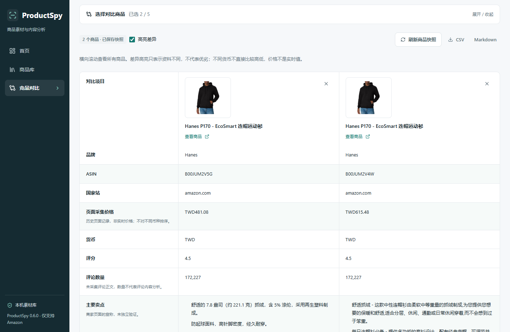
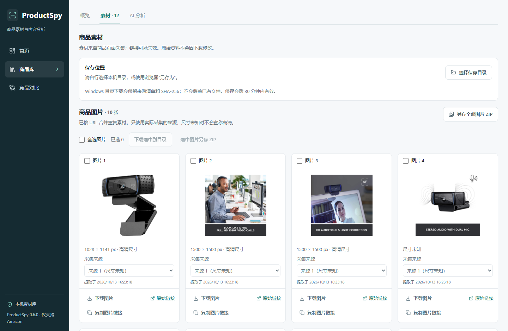

# Phase 17：素材管理与竞品对比

版本 **0.6.0**，日期 2026-10-13。基于 v0.5.2 / `b3d873e` 继续开发，保留本地优先的 Next.js 工作台、MV3 扩展、Windows 便携启动器、安全配对和商品分析历史。不公开 Release，不提交 Chrome Web Store，不调用付费模型。

## 完成的功能

- 素材按图片 / 视频展示。实际采集的同图不同来源可选择，显示页面声明尺寸；不构造高清 URL，未知尺寸和旧记录提取时间明确标识。
- 图片多选、单项另存、选中 / 全部图片 ZIP，Windows 原生目录选择、逐项保存、成功 / 重复 / 失败计数、失败原因、取消、显式重试和打开目录 / 文件位置。
- URL 与已下载字节 SHA-256 去重，名称含商品名、ASIN、类别与序号。目录写入使用临时文件和硬链接发布，不覆盖其他文件；已有文件复用前验证实际哈希。来源清单包含商品、页面、资源、时间、大小与下载结果，用户修改过的清单不会覆盖。
- MP4 / WebM 下载沿用严格 Amazon HTTPS CDN 白名单，校验 MIME、签名、长度、超时并禁止重定向。HLS 只标识流媒体和提供原链接；失效、非允许域名、受保护或超限资源不给出虚假成功。
- 独立竞品对比：从商品库或详情加入 2–5 个不同 ASIN，保存 / 重载 / 重命名 / 删除方案、调整成员、差异高亮、横向可访问表格、窄屏适配、CSV / Markdown 导出。
- 商品图、名称、品牌、ASIN、国家站、历史价格 / 币种、评分 / 评论数、卖点、商家列出的规格、媒体数量及时间并列展示。缺失显示未知；不同币种不排高低，不把采集价声称为实时价。
- AI 对比沿用 Provider、参数偏好、逐次真实请求授权、结构验证、超时、限流、持久化请求编号、并发 / 每日限制和用量账本。七个内容分区、条目 / 分区 / 整篇复制、编辑、重新生成、完整历史及恢复、Markdown 导出均可使用。
- 页面记录、商家宣称、推断、待核实信息分开；证据中的事实与商家宣称由服务端采集资料重建，不采信模型自行声明的事实。没有评论正文，不声称分析真实评论。结构验证不是模型真实性证明。

操作细节和边界见 [素材与对比指南](media-comparison-guide.md)。

## 数据结构与保护

原商品库本地文件仍为 schemaVersion 2，商品交换备份仍为 schemaVersion 1。新增可选 `specifications`（`name/value/source:page`）及 `mediaMetadata`（实际 URL、类别、所属 ASIN、来源页、时间、可获取尺寸）。缺失字段兼容旧商品；读取不会自动重写或清空库。规格来自商品自身表格，不扫描推荐 / A+ 对比表，也不独立验证商家参数。

独立 `comparisons.json` 使用 schemaVersion 1，每方案保存完整商品快照、快照更新时间、结果、生成参数与完整分析历史。原商品删除或更新不改方案，刷新需要明确确认；不存在的商品快照继续保留。方案修改不写原商品库。快照时间与分析写入时间分离，避免生成后误提示资料过期。修改使用版本冲突检查、单路径串行事务、临时文件原子替换；损坏文件保留并报告错误。

最多 200 个方案、每方案 50 个分析版本、文件 / 导入最多 25 MiB。满时拒绝新请求或写入，不删除原历史。方案 JSON 恢复单独预览冲突；重复方案两种安全选项都保留当前内容，不覆盖人工分析。未知字段、非法 URL、错误 ASIN、重复编号、异常版本 / 文件拒绝整份导入。

原商品库备份不自动包含对比方案。两份分别导出；精确备份请停止服务后复制完整用户目录，同时备份自己选择的素材文件夹。Key、配对、会话、设置和用量不进入商品 / 对比导出。旧版不识别新增字段；回退须使用升级前备份，避免旧版写回新版库丢失新增字段。

## 已复现的问题与修复

| 编号     | 证据                                                                                  | 修复                                                                                                     |
| -------- | ------------------------------------------------------------------------------------- | -------------------------------------------------------------------------------------------------------- |
| PS17-001 | 新图库 fixture 实际复现：有当前主图时，单一不匹配颜色组仍被补入                       | 单组兜底仅在没有当前主图时使用；回归保留原 47 项 extractor 测试                                          |
| PS17-002 | 德国 / 英国真实 HTML 含 `/errors_page/validateCaptcha`，初始工具只标为无法识别        | 插件明确提示访问验证；工具同时识别验证表单。独立 HTML 审计纠正分类，不改写原采集记录、不重试限制页       |
| PS17-003 | 首轮真实素材截图：C920 已存多来源，但下拉选项未显示                                   | 将匹配当前 ASIN、国家站与图片身份的实际元数据来源加入目录；回归排除其他商品来源，最终截图核对实际切换    |
| PS17-004 | 文件及网络 Stub 回归复现：修改清单、已移动 / 替换文件、伪装 MP4 的 AVIF、取消目录选择 | 清单哈希保护、实际文件哈希校验、MP4 品牌检查、取消控制器和延迟选择拒绝；不假称 Amazon 曾发送这些恶意内容 |
| PS17-005 | 真实生产构建追踪把源码测试复制进 standalone                                           | 排除测试 / 测试数据 / 分发缓存追踪，Vitest 排除构建副本；最终包内测试文件与私有数据文件均为 0            |

后续实际 Windows E2E 又遇到一次 `products.json` 原子替换的 `EPERM` 短时锁（PS17-006）。新增有界文件发布处理：只对 Windows 的 EPERM / EACCES / EBUSY 原子重命名等待 20/50/100/200ms，最多 5 次；不删除目标，不重做商品逻辑，不重发 AI 或网络请求。永久锁和磁盘满仍明确失败。补充 6 项回归，保留原文件保护。

验收工具也出现过 MV3 Worker 15 秒启动等待超时、独立测试会话密集触发既有 30 次/分钟限制，以及显式匿名场景继承测试会话。改为独立 45 秒启动等待、测试进程内复用自己的 HttpOnly 会话、匿名测试显式清空 Cookie；空状态 fixture 同时覆盖商品与分类接口。没有放宽生产认证或限流，没有跳过失败的断言。失败尝试及最终复测分别记录，不冒称所有初次运行均通过。

这些证据来自真实页面、实际截图、构建产物或标明的回归 fixture，未编造真实用户 Bug / 反馈。

## 真实 Amazon 与媒体结果

正常直接访问 **10 个页面、6 类、4 个国家站**（US / DE / UK / JP），8 次主页面采集成功；2 次普通变体点击成功。合计 10 份成功快照、9 个不同 ASIN；重复国家站同 ASIN 不算新增商品。浏览器为 Chrome for Testing，不是正式 Chrome 稳定版人工验收。

德国和英国各一次访问返回验证表单，HTTP 200 不代表可采集；没有提交验证、绕过或继续抓取。初始工具漏识别新路径，留存 HTML 审计已如实指出。成功的 8 次主页面：ASIN / 标题 / 主图 / 图库 / 页面尺寸来源 / 评分 / 评论数 8 项匹配；价格 / 货币 7 项匹配、1 项缺失；品牌 / 卖点 7 项匹配、1 项缺失；5 页提供绑定公开视频信息、3 页未采集到。描述 8 项仍需逐段内容核对，不冒称全部准确。详细逐页状态见 [实际页面报告](phase17/amazon-results.json)。

独立留存源码审计：610 项媒体元数据 ASIN / 来源页 / 时间均匹配，609 项资源 URL 在源码中找到，1 项保持未知；507 项尺寸与页面声明匹配，103 项未提供。35 项规格与商品自身表格匹配，仍属商家宣称。仅 89 项媒体可直接与当前 DOM 对应，521 项的详细变体 / 视频归属仍需人工核查，不能以填写了 ASIN 字段当作归属质量通过。见 [素材元数据审计](phase17/media-metadata-results.json)。

通过已认证的打包服务实际请求一张公开 C920 JPEG：HTTP 200、92,396 字节，并计算 SHA-256。一条公开视频因超过 **64 MiB** 返回明确 413；不是成功视频下载，也未绕过限制。见 [实际媒体请求](phase17/public-media-results.json)。未完整播放 / 解码所有视频；页面声明尺寸也不是所有文件实际像素的独立检验。

## 自动化验收

| 检查                                       | 最终结果                                                                                                     |
| ------------------------------------------ | ------------------------------------------------------------------------------------------------------------ |
| pnpm install --frozen-lockfile             | 通过，锁文件无变更                                                                                           |
| TypeScript / ESLint / Prettier             | 通过，Lint 零警告                                                                                            |
| Vitest                                     | 50 文件、555 项通过，保留原回归                                                                              |
| Production Build                           | Vite MV3 + Next.js 16.4 standalone 通过                                                                      |
| Playwright E2E                             | 23 项通过，保留原 20 项；新增快照、币种 / 缺失字段、Mock 历史、编辑 / 恢复、删除源商品、备份冲突、幂等与权限 |
| Windows Portable                           | 10 项通过：内置运行时、端口冲突、单实例、停止、持久化、重装、DPAPI、异常恢复及 HTTPS 保护                    |
| 冻结 0.5.2 / 0.5.1 / 0.5.0 / 0.4.0 → 0.6.0 | 每个路径 18 项通过；使用实际旧包及隔离资料，不重建旧包冒充升级                                               |
| ZIP 检查                                   | 4 项通过，原始路径、CRC32、逐文件 SHA、清单、敏感文件模式、扩展权限 / CSP / 内嵌一致性                       |

升级验证包括完整旧商品、人工分析和历史、分组标签、DPAPI 设置原字节、原配对令牌、旧用量账本和同浏览器偏好；新对比方案生成 / 编辑 / 恢复、备份跳过重复、删除源商品、重启均不改变原商品分析。未使用私人商品、真实 Key 或浏览器 profile。

100 / 500 合成商品性能回归保留；分页 DOM 限制 36 件，执行筛选、翻页、批量标签、备份 / 恢复及历史检查。单机耗时只用于本机回归，不代表普通设备或最大尺寸历史的保证。最终时间与所有产物 SHA-256 见 [机器报告](phase17-results.json)。

## 实际截图

截图来自隔离的 **Windows 便携版实际生产服务**，使用本轮真实 C920 与两件 Hanes 变体采集资料；对比分析明确使用本机 Mock，无页面 / API 响应替换。生成 8 张 1440 / 375px 截图并检查页面宽度。复核发现 PS17-003 后已重构建并重新拍摄；来源切换控制实际验证，不将旧截图当最终效果。





其他 Mock 分析、编辑、视频及移动界面与哈希见 [截图清单](screenshots/phase17/provenance.json)。截图不是 Windows 原生目录窗口或正式 Chrome 鼠标验收证据。

## 限制与待人工验收

- 正式 Chrome 稳定版、普通 Windows 10/11、DPI / SmartScreen、原生目录选择及 Explorer 打开文件位置尚无完整人工证据。
- 目录会话 30 分钟或服务重启后失效，需要重新选择；已保存文件 / 清单保留。原子发布依赖硬链接（推荐 NTFS），FAT / exFAT 失败时使用浏览器另存。
- 不支持 HLS 下载、DRM / 登录 / 验证绕过、全部视频 CDN 或超限文件。失效链接仍需重新采集 / 手动核对。
- 不支持文件选择 API 的浏览器，需要用户自己开启并确认下载前询问保存位置；应用无法程序化核实设置。
- 内容哈希去重针对实际下载字节及会话 / 已知确定文件，不扫描整个用户磁盘、不声称对未下载素材做过内容去重。
- 编辑遇到 409 会保留草稿，但不自动重基到最新结果；可导出草稿并核对最新方案。
- 真实模型请求 **0**，只有 Mock / Stub 协议、授权与事实边界验证；不报告真实模型质量达标、商业效果、真实费用或用户评价。
- 真实页面访问限制、部分素材归属、描述质量和实际视频播放仍待核查。原 Phase 16 的小配对窗口人工证据缺口未以普通布局测试冒称解决。

v0.6.0 工程产物可用于本机功能体验；这些剩余项不应被解释为正式 v1.0 全部验收完成。

## 复现与分发

```powershell
pnpm install --frozen-lockfile
pnpm typecheck
pnpm lint
pnpm format:check
pnpm test
pnpm build
pnpm test:e2e
node scripts/package-windows.mjs
pnpm test:portable
pnpm test:upgrade --from artifacts/ProductSpy-0.5.2-windows-x64 --to artifacts/ProductSpy-0.6.0-windows-x64
node scripts/validate-release.mjs
node scripts/phase16-amazon-capture.mjs --phase 17 --output .test-data/phase17-amazon/new-run
```

正常 Amazon 访问不保证再次可达；遇验证即停止。进程回归需空闲 3000，仅结束已确认自己创建的服务。截图 / 媒体工具要求明确的隔离测试目录，不能对默认用户库运行。

Windows 便携包与 Chrome Extension ZIP 在 `artifacts/`。双击解压后的 `ProductSpy.cmd`；扩展加载包内 `extension` 目录并保留安全配对。README、[Windows 指南](windows-guide.md)、隐私说明和新模块指南已更新。GitHub v0.6.0 为 **Release 草稿**，不公开；旧草稿与冻结包保持原样。
