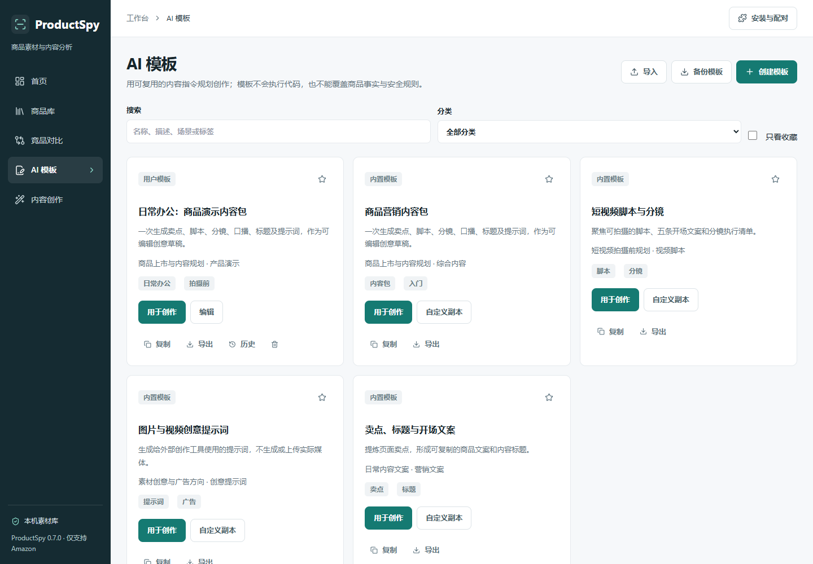
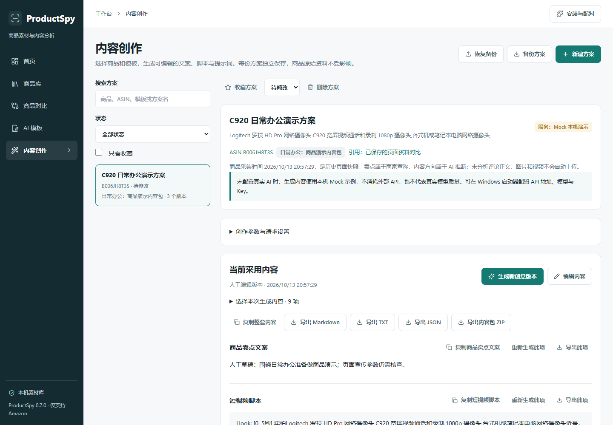
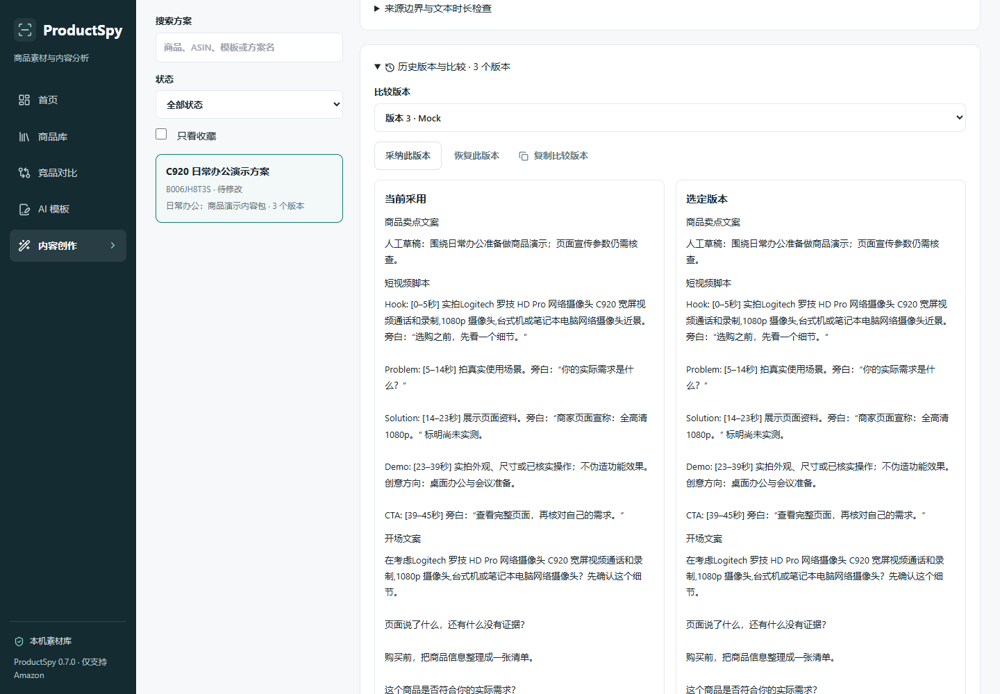

# Phase 18：AI 模板与营销内容生产工作台

版本 **0.7.0**，2026-10-13。基于原有 ProductSpy 0.6.0 开发；保留 Amazon MV3、Windows 便携启动器、本地数据、安全配对、商品 / 分组标签 / 素材 / 竞品对比 / 完整 AI 历史。未公开 Release，未提交 Chrome Web Store，未执行付费模型请求。

## Phase 17 前置核查

开始开发前，本地无未提交变更，分支为 `codex/phase17-media-comparison`。实时读取 GitHub main，已是 **`a1c749e0760015f58c258b56837a416e2d4cb74a` / v0.6.0**，并非仍停在 v0.5.2。本地 HEAD 与其一致。该提交包含素材来源 / 去重 / 安全下载、独立竞品快照、AI 对比 / 完整历史，以及 Phase 17 报告和实际截图。

现场复跑：安装、TypeScript、Lint、Prettier、555 单元测试、23 E2E、便携 10 项、冻结 v0.5.2 → v0.6.0 升级 18 项和 ZIP 检查全部通过，之后才创建 `codex/phase18-ai-content-workbench` 开发。没有空提交或强制覆盖远程历史。

已核实原 v0.6.0 Release 为草稿、9 个附件，包含 Windows / 扩展 ZIP、真实截图与验收材料；既有旧版本包和草稿保留。Phase 17 的真实 Amazon 结果及人工待办仍见[原报告](phase17-validation.md)，本阶段不把旧页面重新保存当作新增 Amazon 采集验收。

## 已完成

- **AI 模板**：4 个内置模板，用户创建 / 编辑 / 复制 / 删除，名称、描述、适用场景、分类、标签、收藏、搜索、输出项目、Prompt 和结构要求；导出 / 备份 / 校验预览 / 跳过冲突导入，完整历史和恢复。内置定义只读，复制后独立；内置收藏只保存在本浏览器，用户模板收藏保存在模板文件。
- **安全变量**：商品、市场、语言、平台、时长、风格、目标和有来源的已保存对比结论；白名单、缺失提示、非递归替换、长度限制和实际预览。无 eval、脚本或远程代码，不执行用户 JSON Schema；固定九类输出容器，用户可以选内容类型并用有界文本约定内部结构。
- **内容创作**：选择现有商品和模板，保存多份命名方案及创意方向。生成卖点文案、五段短视频脚本、至少五条开场、分镜、口播、标题说明、图片 / 视频提示词、广告方向；完整内容包是这些选项的组合。只生成文本，不渲染或发布。
- **参数与调用**：US / UK / EU / JP，中文 / 英文 / 日文，TikTok / Reels / Shorts，四种风格、营销目标、自定义要求 / Prompt、5–180 秒（15 / 30 / 60 快捷值）。沿用 Windows AI 地址 / 模型 / DPAPI Key 设置、固定系统规则、超时、结构校验、共享限流 / 并发 / 每日计数、费用估算和错误记录；首次和后续请求都尊重选中的内容范围，不自动重试或批量收费。
- **编辑保护**：生成后的新结果保存为候选，保留当前人工内容；单项生成合并所选内容，其他分区保持原文。比较、明确采用、恢复为新历史、整篇 / 单项复制、收藏和草稿 / 待修改 / 已完成状态。浏览器保留编辑草稿和请求 UUID，支持取消 / 刷新后的草稿恢复，以及断线后只查询已保存结果；重新恢复同编号不重复调用，真实模式仍要求确认。
- **事实边界**：页面资料、商家宣称、AI 推断、未知分区；事实由服务端重建，不信任模型自行分类。引用竞品分析保留方案、版本、时间、ASIN 和 URL，结论保持推断。没有评论正文，不分析评分背后的评论；媒体默认不上传。
- **导出**：单项 / 整套 Markdown、TXT、JSON 和 ZIP，清晰命名、来源与生成参数。ZIP 仅放所选文本、JSON / Markdown 和说明，不抓取或复制媒体。浏览器实际 ZIP 下载、CRC、路径、内容与无媒体检查已执行。

界面保持原深色侧栏与青绿操作色，加入 `/templates`、`/content` 和商品详情快捷入口。素材继续在商品详情中管理，安装配对与 AI 设置沿用现有入口，没有重复页面。操作见[内容创作指南](content-creation-guide.md)。

## 数据兼容与安全

原 `products.json` schemaVersion 2、商品交换备份版本 1、`comparisons.json` schemaVersion 1 不变。新增独立 `templates.json` 和 `content-plans.json`（均 schemaVersion 1），不在读取时修改旧商品。方案保留商品、模板和所引用对比快照，源商品或模板删除后仍可查看。新增独立备份，冲突不覆盖已有人工内容或历史。

旧 `AnalysisOptions.duration` 继续为 15 / 30 / 60；新内容参数允许 5–180。旧用量记录 `options` 保持兼容，新记录使用准确的 `contentOptions`，不伪装成接近的旧时长；账本清除重复的自定义 Prompt 正文，方案私有参数仍可复现。

按单路径串行事务和 CAS 保护，临时文件原子替换沿用 Windows 有界 rename 重试，不重做商品逻辑或 AI 请求。损坏文件保留并报错。每类 200 个用户模板 / 内容方案、每个 50 版本、文件和导入 25 MiB；达到上限拒绝而不截断历史。

本机来源、HttpOnly 会话、CSRF、写入身份及扩展权限检查保留；扩展不能访问模板、内容管理或收费 AI 接口。Key 仅在服务端配置，不放模板、网页、提示词或包中。新数据文件加入分发排除与回归检查；最终 ZIP 原始路径、CRC32、逐文件 SHA-256、Manifest 权限、敏感文件及凭据模式检查通过。

## 实际发现与修复

| 问题                       | 证据和修复                                                                                                                   |
| -------------------------- | ---------------------------------------------------------------------------------------------------------------------------- |
| 同编号对比快照可能漏验 URL | 独立恶意备份 fixture 复现：先去重再校验会漏掉不同快照。逐份校验 URL / ASIN，绑定商品、模板、元数据及前序历史；原数据不写回。 |
| 模板重复变量展开过大       | 100 次引用大描述的 fixture 复现；单次展开限 64,000 字符、请求资料限 128 Ki 字符，预检先于账本及网络。                        |
| 局部生成时长提示错误       | 不再估算未合并占位口播；按最终候选、人工编辑或恢复后的文本重算。仅文本估计，非实拍时间。                                     |
| 导出的内置模板编号冲突     | 导出为新编号及一致历史的独立用户副本，严格备份 schema 可再导入。                                                             |
| 取消编辑后草稿入口不足     | 保留即时恢复入口，阻止新编辑静默覆盖旧草稿；刷新、取消、恢复、人工保存通过实际 UI 回归。                                     |
| 生成范围与首次选项不一致   | 首次也发送并验证选中的字段；未选项用明确占位而不要求模型创作。完整结构仍可能影响费用，未承诺按分区等比例降价。               |
| 首次结果自动与自身比较     | 首次生成只展示当前结果；后续候选才打开比较。                                                                                 |
| 模板编辑复选框挤压标签     | 真实生产截图复现逐字换行；固定 16px 复选框、标签整体换行，新增桌面及 375px 标签高度断言，重建后重新截图。                    |

验收工具初次存在未完成测试的格式问题、匿名来源 403 / 会话 401 断言混淆，以及升级工具假设只有一个对比备份冲突。分别完成格式、区分两种拒绝状态、按已有方案实际冲突数量断言并复测；未放宽生产规则或跳过断言。失败尝试保留在 `.test-data`，最终机器报告引用实际成功证据。

## 最终自动化结果

| 检查                                       | 结果                                                                             |
| ------------------------------------------ | -------------------------------------------------------------------------------- |
| pnpm install --frozen-lockfile             | 通过，锁文件无变更                                                               |
| TypeScript / ESLint / Prettier             | 通过，零 Lint 警告                                                               |
| Vitest                                     | 60 文件、642 项通过；保留原 555 项                                               |
| Production Build                           | MV3 Vite + Next.js standalone 通过                                               |
| Playwright E2E                             | 27 项通过，0 跳过 / 失败 / flaky；原 23 项保留                                   |
| Windows Portable                           | 10 项通过，包含内置运行时、单实例、端口、停止、重装、DPAPI 和异常恢复            |
| 真正冻结 v0.6.0 → v0.7.0                   | 22 项通过，含旧对比及媒体来源的字节保留                                          |
| v0.5.2 / v0.5.1 / v0.5.0 / v0.4.0 → v0.7.0 | 每条路径 21 项通过，未重建旧包冒充升级                                           |
| ZIP 完整性与安全                           | Windows / 扩展两包 4 项通过；2203 / 226 条文件，CRC / 哈希 / 权限 / 私有路径检查 |

升级包括商品 ID / ASIN、完整商品及旧人工分析 / 历史、分组标签、DPAPI 设置、原配对、用量、同浏览器偏好；新增模板及内容生成 / 编辑 / 候选 / 恢复 / 备份后真实停止并重启，字节与记录仍一致。100 / 500 合成商品性能回归保留。合成数据不冒充真实 Amazon 验收。

最终产物大小、SHA-256、检查时间、证据路径及截图清单见 [phase18-results.json](phase18-results.json)。所有测试在隔离 `.test-data` 中进行，没有读取真实用户 Key、私人商品库或浏览器 profile。

## 实际运行截图

截图来自 v0.7.0 **Windows 便携包的实际生产服务**。使用 Phase 17 留存的公开 C920 / Hanes 真实采集文字重新保存到隔离库，AI 明确为 Mock；无 API / HTML 响应替换、DOM 内容修改或伪造页面。重新保存时间不是新一轮 Amazon 采集准确性证据。实际模板、编辑、历史比较、变量预览与移动页面共 8 张，来源和哈希见 [provenance.json](screenshots/phase18/provenance.json)。

## 分发、限制与人工待办

Windows 包 `artifacts/ProductSpy-0.7.0-windows-x64.zip`，完整解压后双击 `ProductSpy.cmd`；扩展 ZIP 为 `artifacts/ProductSpy-0.7.0-extension.zip`。用户目录仍为 `%LOCALAPPDATA%\ProductSpy`，更新程序不覆盖它。完整安装及 AI 设置见 [Windows 指南](windows-guide.md)。源码推送 main，v0.7.0 仅准备草稿，不公开。

- **真实 AI 请求 0 次**；六类合成商品 × 三语言只验证 Mock 合约和 Stub 协议。实际语义、营销具体性、母语质量、费用、人工编辑时间和可拍摄性仍待授权后验证。见 [AI 质量范围](phase18-ai-quality.md)。Mock 不解释任意 Prompt 的全部语义，不是通用模型或商业质量认证。
- 正式 Chrome 稳定版鼠标操作、其他 Windows 10/11 设备、DPI / SmartScreen、原生目录选择和 Explorer 仍需人工证据；本机 headless 便携测试和 Chrome for Testing 不能替代这些验收。
- 浏览器草稿、内置收藏与创作偏好属于当前浏览器；清理网站数据或存储不足时不能保证保留未保存草稿。重要内容保存并导出；并发冲突不自动重基覆盖。
- 模板输出使用固定九类容器和有界结构要求，不支持执行任意脚本或动态 JSON Schema。文本量估算不等于拍摄或说话时长；安全提示不证明真实模型绝不编造。
- 原 Phase 17 的 HLS / DRM / 登录限制、媒体域名与大小限制、目录令牌重启失效、未知归属等边界继续保留。
- 回退旧程序必须用升级前数据副本；旧版用量 schema 不识别新内容记录，不应在新版目录写回。产品、模板、内容及对比分别备份；停止后复制完整用户目录用于精确离线回退。

当前工程交付可用于本机体验；上述待验收项没有标记为正式 v1.0 全部通过，未编造外部用户、真实模型评分或上架结论。
