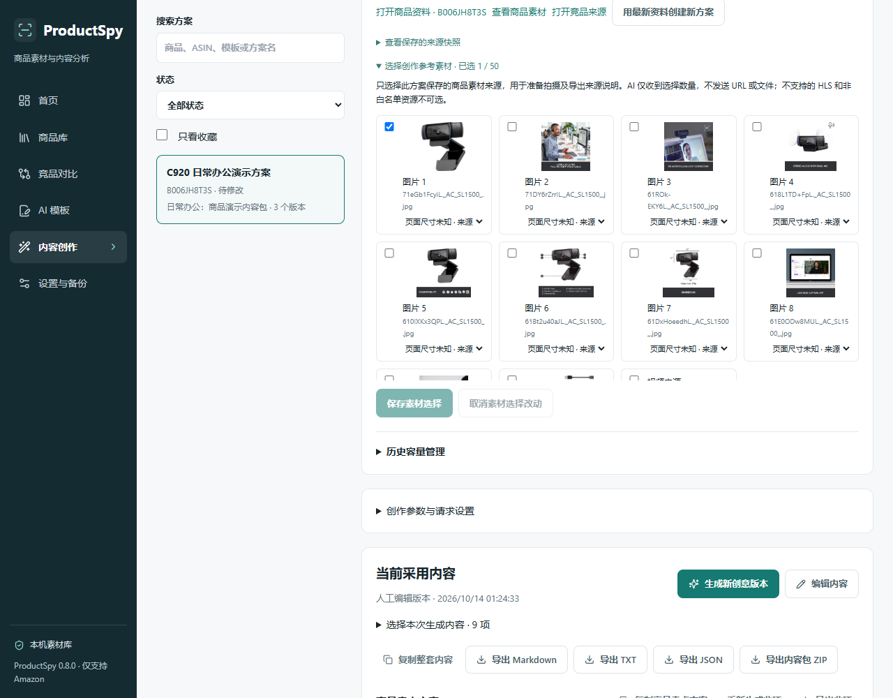
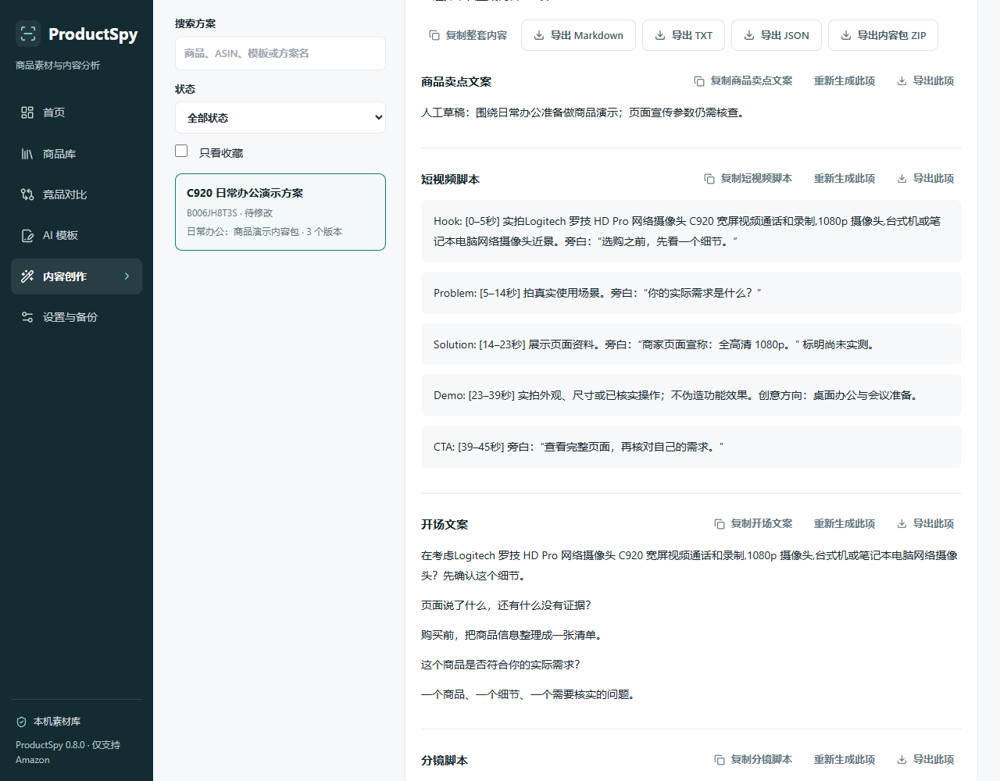

# Phase 19：全模块集成、稳定性与产品体验验收

版本 **v0.8.0**，2026-10-14。基于远程 main 的 v0.7.0 / `a0f12f19f4b216eba3aeebb3b69b199d11ab4213` 开发。没有重建架构、增加其他平台、收费账户、云端 SaaS、视频渲染或自动发布；没有邀请外部测试用户，没有调用真实付费 AI，没有提交 Chrome Web Store。Release 保持草稿。

实际命令、时间、文件 SHA 和原始证据路径见 [机器验收结果](phase19-results.json)。这些结果是实际执行结果，不能替代尚未执行的人工验收。

## 完成的集成与修复

- 商品详情直接进入竞品对比、模板选择及内容创作，保留商品 ID / ASIN / 来源。
- 内容创作引用保存的商品分析与竞品结论，明确标记未验证推断；每次生成保留来源版本和参数，不冒充评论正文分析。
- 内容方案核对商品资料、分析、模板和竞品结论状态。实质更新或删除明确提醒，收藏/分组标签调整不造成无意义的资料过期提示。
- 「用最新资料创建新方案」先载入可检查的最新资料，再明确创建独立方案；原快照、当前人工结果及全部历史不变。原商品删除后，独立方案仍保留完整来源。
- 创作参考素材按实际素材身份聚合，同图不同尺寸在卡片内选择来源；不删原 URL 或旧版本选择，最多50项。来源匹配和域名校验保留，模型仅收到数量，导出只包含文本来源。
- 新增「设置与备份」统一入口：五文件业务备份、容量说明、恢复预览、引用/版本/数量校验、冲突保留及二次确认。独立备份继续保留。
- 四类历史支持数量/占用、接近上限提醒、导出归档、指定旧版本清理。保护当前与恢复节点；人工编辑不自动删除，50上限仍生效。
- 保留旧分析/对比/模板/内容历史，数据 ID、用户设置、配对、原子写入及 Windows 便携架构。

使用见[完整工作流、备份与历史指南](workflow-backup-guide.md)。

## 有证据的问题与处理

| 编号     | 优先级   | 复现证据与实际修复                                                                                                                                                            |
| -------- | -------- | ----------------------------------------------------------------------------------------------------------------------------------------------------------------------------- |
| PS19-001 | P0       | 备份复制阶段进程异常留下非空暂存目录但没有日志，后续读写阻断。改为先 staging 日志、原文件哈希核对、prepared 后才发布；故障注入验证恢复/回滚，未知日志保留。不是实际断电试验。 |
| PS19-002 | P2       | 内部发布函数原先只检查存在锁上下文，共享上下文也能通过。改为必须独占上下文，回归拒绝错误调用；未发现外部接口可利用路径。                                                      |
| PS19-003 | P1       | 原内容 Provider 输入遗漏已保存商品 AI 分析。实际 Stub 请求体回归验证新增有来源的未验证推断引用，保留事实边界。                                                                |
| PS19-004 | P2       | 仅收藏模板也提示创作来源过期。调整实质资料比较，回归保留真正更新/删除提醒。                                                                                                   |
| PS19-005 | P2       | 实际清理成功、历史剩余2份，但父级时间刷新立刻清掉成功反馈。调整状态重置依赖，E2E继续要求成功提示、当前人工结果与恢复节点完整。                                                |
| PS19-006 | P2       | 真实界面截图显示同图尺寸来源重复占满选择卡片；聚合卡片后又暴露说明文字落入18px列。改为来源下拉框和明确说明列，新增可读宽度断言、保留所有原来源及生成记录。                    |
| PS19-007 | P2       | 较大合法业务备份缩进后可能超过回导限制。统一序列化在必要时使用紧凑 JSON，仍验证100MiB总上限与各25MiB文件上限。                                                                |
| PS19-008 | 测试设施 | 重复单测的源码目录文件写入/复制/清理出现超时。记录失败日志，隔离OS临时资料并在测试进程结束后发布质量报告；未删除断言或放宽测试超时，完整三轮重复通过。                        |

新 E2E 最初误把「载入最新资料」当作直接完成创建，并使用不存在的零选择计数文案；已按真实工作流修正。全链路增加到200多个动作后，Trace确认按步骤继续前进却耗尽旧90秒总期限，单条完整链路调整到180秒；单个动作、接口与安全断言不变。最终没有跳过或 flaky 测试。

## 数据与安全

原五个业务文件和 schema 继续可读；新增可选参考素材、生成来源、已归档父版本及摘要字段，旧资料无需清空。业务恢复使用目录读写屏障、staging/prepared/committed日志和原字节哈希；发布失败回滚、普通读取前恢复，损坏/未知日志保留并阻断。

完整业务备份包含商品分组标签、对比、用户模板、内容快照及历史、AI 用量/防重复请求指纹；明确勾选时附四类浏览器偏好。排除 API Key、Cookie、配对配置、Windows DPAPI 设置、会话、编辑草稿及下载媒体。保留已有用量，旧备份不能重置当前真实调用限制。备份不是对个人文案的敏感内容扫描器，分享前需自行核对。

没有扩大扩展权限或绑定公网。来源/会话/写入校验、SSRF与媒体白名单、模板不可信数据边界、真实请求授权与无收费自动重试均保留。安全证据详见[安全报告](phase19-security.md)。

恢复归档不会自动覆盖同 ID 实体；历史归档是人工恢复参考，需要自动完整恢复时使用清理前的模块/业务备份与独立目录。旧程序不认识新版可选字段，**回退需使用升级前数据副本**。不能把正向兼容解释成可无条件用旧程序写回新版数据。

## 自动化与 Windows 实际产物

| 检查                                          | 最终结果                                                                                      |
| --------------------------------------------- | --------------------------------------------------------------------------------------------- |
| pnpm install / TypeScript / ESLint / Prettier | 通过；已实际执行 pnpm format 与 format:check                                                  |
| Vitest                                        | 67文件、696项通过；生产构建后的三次完整重复均通过                                             |
| 生产构建                                      | 扩展 Vite 与 Next.js standalone 通过                                                          |
| Playwright E2E                                | 31项通过，0失败/跳过/flaky                                                                    |
| Windows Portable                              | 实际便携包10项生命周期检查通过                                                                |
| v0.7.0 → v0.8.0                               | 26项；真实旧程序生成资料，新程序首次读前5文件字节不变，ID/完整历史/配对/DPAPI与浏览器偏好保留 |
| v0.6.0 → v0.8.0                               | 22项通过                                                                                      |
| v0.5.2 / v0.5.1 / v0.5.0 / v0.4.0 → v0.8.0    | 每条21项通过                                                                                  |
| Release ZIP                                   | 两包完整CRC、路径/敏感内容、Manifest与内嵌扩展校验通过                                        |

全链路 E2E 使用实际构建 MV3、真实 activeTab 动作、安全配对及本机服务，Amazon HTML/媒体为明确标注 Fixture。不能当成真实 Amazon 成功率。恢复异常与并发测试包含实际文件系统原子操作、故障注入、junction拒绝、坏文件保留、更新冲突、备份round-trip、用量保护与并发请求不丢失。

Windows 本机为 Windows 11 专业工作站版 x64 / `10.0.26300`，Node24.14.0；自动化浏览器为 Chrome for Testing156.0.8078.4。双击/关闭窗口的鼠标操作、其他普通设备、正式 Chrome 稳定版、高 DPI、SmartScreen及原生目录窗口仍待人工验证，不能由 Headless 测试替代。

## 真实 Amazon 正常访问

新执行10个页面、六类商品、四个请求国家站（US/DE/UK/JP）。9个主页面采集成功，1个服装页导航35秒超时；另一次正常可见变体切换成功，共7个不同ASIN。未绕过验证码、登录或保护，不把超时推断成已证实反爬。

以下仅按9个实际成功主页面统计；另一个超时页面没有字段质量结论：

| 字段                                 | 与页面可比信息一致 | 缺失或仍需核验                                                              |
| ------------------------------------ | ------------------ | --------------------------------------------------------------------------- |
| ASIN / 标题 / 主图 / 画廊 / 高清来源 | 各9/9              | 高清来源一致不是逐张像素解码验收                                            |
| 价格 / 货币                          | 各7/9              | 2页无当前可比价格；保留未知。页面显示TWD就采集TWD，不根据国家站强行替换币种 |
| 品牌                                 | 8/9                | 1页未提供可当作品牌的资料，作者不冒充品牌                                   |
| 卖点                                 | 8/9                | 1页无可比卖点                                                               |
| 评分 / 评论数                        | 各9/9              | 没有评论正文，不声称分析评论内容                                            |
| 视频URL页面归属结构                  | 5/9                | 4页未提取视频；网络HEAD不等于解码/播放成功，内容归属仍需逐条人工观看        |
| 描述                                 | 不给虚假成功率     | 8页需要完整内容核对，1页无可比描述                                          |

原始 HTML/profile 保留在忽略的 `.test-data`，公开报告仅字段裁决、URL/元数据和证据哈希：[真实页面结果](phase19/amazon-results.json)。重复解析与正常变体有记录；实际保存/重复更新由隔离 E2E、便携与升级检查覆盖。

## 生产性能

冻结 v0.7.0 与最终 v0.8.0 便携服务，隔离数据目录，通过真实API导入。100/500/1000个商品、20份对比、100个模板、100个内容方案，合计1600个商品分析版本、1000个模板版本及991个内容版本。**全部为合成容量样本，不是1000个真实商品验收。** API重复读取7次，记录中位/P95；测试不是跨设备统计研究。

最终 v0.8.0：启动约1.9秒；100/500/1000列表API中位约3.5/7.9/51.9ms，1000商品页面就绪约281ms、搜索约12ms；100内容方案API约128ms、页面约386ms。完整8.67MB业务JSON导出约520ms。10次并发读取约426ms，5次并发原子保存约464ms，1000商品及历史保持完整。测试目录约12.2MB，服务工作集末次采样约416MiB，不是持续监测峰值，也不包含浏览器。

32逻辑处理器/64GB本机；旧版1000商品API中位约65ms、100内容方案约118ms，只有一次同设备基线，不据此宣称普遍提速。未发现值得大改架构的明显瓶颈；保留文件/数量/历史上限。批量素材失败、重试和取消为实际UI+固定媒体Fixture及文件系统回归，未把它当作真实Amazon带宽/全量视频性能。数据与详细时间见机器结果中的 performance。

## 截图与交互证据

57张最终实际便携界面PNG，覆盖全部模块与320/375/768/1280宽度、素材来源、对比表、编辑、历史、删除源快照、首次空态、配对弹层及400px插件首次引导。没有DOM伪造或模型绘制截图。页面数据使用保留的 Phase17 C920/Hanes真实公开采集；**截图数据不是本轮重新采集的成功率证据**。AI展示全部Mock，人工文字是明确编辑演示。

完整图片、尺寸、SHA及实际交互：[截图证据](screenshots/phase19/provenance.json)。网页配对弹层四宽度可读、Escape回焦通过；此前55×58原生小窗口没有复现，仍待人工验收，未虚称修复。

## 产物与结论

`artifacts/ProductSpy-0.8.0-windows-x64.zip`、`artifacts/ProductSpy-0.8.0-extension.zip`、截图ZIP、报告与SHA清单。完整解压便携包后双击 `ProductSpy.cmd`，按[Windows指南](windows-guide.md)加载扩展并配对。源码正常提交 main，GitHub v0.8.0 Release只准备草稿，不公开发布。

**工程集成验收合格，可作为 v1.0 候选阶段基础；尚不能认定真实用户/真实模型质量和全部原生桌面验收完成。** 仍需正式 Chrome、多设备 Windows/高DPI/系统提示/原生目录操作、原配对小窗口、视频解码与描述核对、明确授权后的真实模型质量评估及实际断电/磁盘异常测试。没有编造用户反馈、付费模型评分或正式审核结论。
