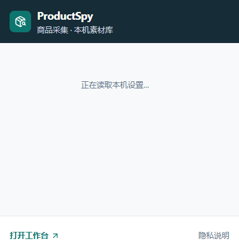
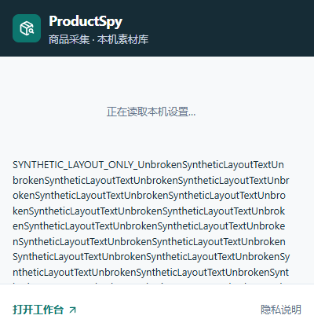

# ProductSpy v1.0.0：发布前全量质量验证

执行日期：**2026-10-17（Asia/Shanghai）**。本轮实际重测，基线为远程 main `0880b927b11218836c15bc8b1258f23c8e648c04`；冻结正式包源码记录 `43d786fc8bc3e3ce495eaed84b8ab4588e111034`。这是统一质量验收，不新增业务阶段。

**结论：工程自动化通过；尚未具备“全部真实环境已通过”的公开发布证据。** 没有新确认的产品 P0/P1/P2，没有修改生产代码或冻结包。详细人工清单维持 **9 PASS / 44 PENDING / 0 FAIL，共 53**；本轮没有新增人工 PASS。缺少证据不等于发现缺陷，也不等于已清零。

机器结果：[JSON](v1.0.0-final-quality-validation.json)。合并操作单：[剩余人工验收清单](v1.0.0-final-manual-checklist.md)。历史人工结果保留，6/6 烟雾及10/10备份专项不重复计入53项。

## 环境、隔离及冻结边界

- Windows 11 Pro for Workstations，10.0.26300 / x64；Node v24.14.0，pnpm 10.32.1；便携内置 Node24.14.0。
- 自动化浏览器为隔离 Chrome for Testing156.0.8078.4。已安装正式 Google Chrome155.0.8059.80，仅核对程序版本；本轮没有把它的 toolbar 安装/交互标记通过。
- 所有写入和故障注入限于 `.test-data` 合成资料。Mock 环境过滤继承的 AI_*；没有读取私人 Key、调用付费模型、修改生产 ACL 或停止未知进程。
- 原生非Headless启动器以独立 DataRoot/RuntimeRoot运行，服务实际返回1.0.0/mock，启动token未提权；Computer Use未返回ProductSpy可操作窗口，未点击原生按钮。仅正常请求停止本次服务并清理精确自有启动器，端口释放。它不是资源管理器双击或GUI退出验收。
- 源码 `pnpm build` 只生成开发构建输出；没有调用 package 脚本。全部冻结ZIP、7件正式附件、既有校验文件、人工CSV和12个Release身份/附件元数据前后不变；便携树按manifest2334记录校验。

## 本轮命令与自动化结果

下表均为本轮执行，UTC开始/结束、毫秒耗时、日志相对位置及SHA-256见JSON的commands。日志保留在本机ignored目录，GitHub提交脱敏结果，不上传profile或运行库。`pnpm format`确实执行；未改变生产源文件。

| 检查                                                        | 结果 / 数量                                     | 证据                                                                             |
| ----------------------------------------------------------- | ----------------------------------------------- | -------------------------------------------------------------------------------- |
| 冻结安装、TypeScript、ESLint、format/write及check、生产构建 | PASS                                            | foundation命令记录                                                               |
| 全量Vitest三次基线重测                                      | 每次736/736，72文件；最终含补充HTTP测试 745/745 | [逐文件结果](evidence/v1.0.0-final-quality/unit-suites.json)                     |
| 冻结便携生产服务上全量E2E                                   | 34/34，0 skipped/flaky/fail                     | e2e-report.json，源扩展与包内扩展逐字节匹配                                      |
| Windows便携生命周期                                         | 13/13                                           | 内置runtime、空PATH、单实例、端口、权限、重装、崩溃清理                          |
| 真正跨版本升级                                              | 9路径 / 216检查                                 | [便携/升级/备份结果](evidence/v1.0.0-final-quality/portable-upgrade-backup.json) |
| 备份恢复专项重测                                            | 28/28单测、4/4E2E、42/42专项断言                | 全新源/目标库、重启、受控文件锁与事务回滚                                        |
| Extension MV3重载与重启                                     | 11/11                                           | [实际worker检查](evidence/v1.0.0-final-quality/extension-lifecycle.json)         |
| 三个AI入口的实际loopback HTTP Stub                          | 9/9                                             | 不连接真实服务、不计真实模型质量                                                 |
| 正式ZIP完整性、哈希、Manifest及敏感路径                     | 4/4                                             | 两个原ZIP及嵌入扩展一致                                                          |
| pnpm audit --prod --json                                    | PASS，115依赖，数据库报告0漏洞                  | [审计回执](evidence/v1.0.0-final-quality/dependency-audit.json)                  |

**通过率口径：**最终规定命令和专项断言均通过；三轮单测、重复E2E及备份子集存在重叠，不相加宣称独立用例总数。开发者模式未配置等QA初始失败保留，定位后重测，不删除失败证据。BLOCKED的Amazon访问、MANUAL_REQUIRED和未授权AI不计作PASS。

## Windows与Chrome边界

便携自动化覆盖文件占位/拒绝写入、空PATH内置runtime、重复启动、mock配置、端口冲突、同版移动、异常自有launcher退出及原资料保留。故障仅作用合成路径，ACL有恢复校验。这些是headless/受控工程检查，不能替代Windows原生保存/取消/选目录、标准用户CMD双击、SmartScreen及125/150/200%真实显示缩放。

CFT E2E实际触发action Popup目标，核对html/body/root/shell、400×420 CSS px、无横向溢出与内部滚动；不同于普通popup.html标签页。新增真实MV3 worker reload和整个隔离浏览器重启，cache/queue/consent/合成token保持一致。合成token未发送，也不称真实配对通过。

首次专项因QA profile开发者模式关闭，reload后的unpacked扩展被Chromium以`1<<24`禁用；后续一次控件属性断言也属于测试设置错误。按正常安装前提在专用profile启用开发者模式后，原有产品断言11/11通过。[完整QA诊断](evidence/v1.0.0-final-quality/extension-qa-diagnosis.json)。没有改生产安全机制、降低断言或把正式Chrome C06改成PASS。

## 真实Amazon采集

正常访问10个主页面，8成功、UK/DE2个验证页BLOCKED；另正常点击Hanes变体成功，合计9次采集、8个唯一ASIN，电子/家居/美妆/服装鞋帽/厨房/图书6类，成功国家站US/JP。不解验证码、不登录、不规避保护；不把验证页算字段失败或虚构成功率。

| 字段                                              | 成功采集中的核对             | 边界                                                    |
| ------------------------------------------------- | ---------------------------- | ------------------------------------------------------- |
| ASIN、标题、主图/图集/高清来源、评分/评论数、描述 | 各9 PASS                     | 商家文本可见一致不等于功效事实已验证                    |
| 价格/币种/品牌/卖点                               | 各8 PASS、1 unavailable      | Crocs等页面未显示的价格保留未知；页面可见TWD不擅自改USD |
| 当前ASIN视频归属                                  | 5 PASS、4无可靠资源          | 识别与可播放性独立                                      |
| 主图/视频可达                                     | 9次图片GET和9次视频HEAD为200 | 不代表完整视频播放、解码或原生目录下载通过              |

[逐页值、时间、公开URL与字段证据](evidence/v1.0.0-final-quality/amazon-fields.json)。9次重复识别的ASIN/价格一致；真实商品未写入测试商品库，入库去重由独立Fixture链路验证。CeraVe/OXO各定次重识别3次，视频分别2/2/2及1/1/1，采集前后回放一致，间隔680–967ms；不是原子瞬时快照，不证明历史问题已定位或永不出现。[时序记录](evidence/v1.0.0-final-quality/amazon-video-timing.json)。

## 业务链路、AI与数据

全量E2E在真实冻结便携HTTP服务上，用独立Fixture完成：扩展采集→保存→去重→商品库/分组标签/筛选→素材→对比快照→商品Mock→模板→内容创作→人工编辑/候选/恢复/草稿→导出→备份/删除测试实体/恢复/刷新。核对ID、ASIN、来源版本、已删来源快照及历史。导出CSV/JSON/Markdown/TXT/文本ZIP由解析器核对结构、安全路径与内容；原生记事本/表格工具交互仍人工待验收。

AI A类：Mock业务通过。B类：真实Provider实现配合模拟HTTP返回通过，包含三个入口、schema/参数、超时、429/Retry-After、错误、无自动重试、一次调用及媒体省略；用量/幂等/不确定费用由现有处理器账本测试覆盖，不冒称纯Provider自己持久化。C类：真实付费模型质量未授权，三个AI人工项继续PENDING，真实请求0。

备份覆盖products/comparisons/templates/content-plans/analysis-usage五业务文件、分组标签、素材元数据、人工与生成历史及引用；不包含Key、配对、Cookie、Windows设置、媒体实体或未保存草稿。全新恢复逐项深比较，忽略导出时间后内容一致；较新人工编辑与重复导入保留；异常格式/损坏/缺字段/版本/私密字段/恶意URL/未知引用/未确认拒绝，stale preview409；受控真实文件锁导致恢复失败后回滚五文件原字节，解锁后显式重试成功，重启再核对。prepared journal异常状态在停止的测试库构造，没有物理断电或杀未知进程。

升级来源为rc.2、rc.1、0.8.0、0.7.0、0.6.0、0.5.2、0.5.1、0.5.0、0.4.0实际冻结包，目标1.0.0；不是同版重解压。按各版本已有能力建立商品/分析/分组/标签/素材/对比/模板/内容/历史/偏好/加密合成AI配置/配对；升级、重启及安全备份后核对。0.2/0.3不在本轮现有升级脚本支持矩阵内，不外推通过。

## 安全与发布材料

源码审查结合本轮单测/E2E/ZIP扫描：本机Host/Origin和绑定扩展token认证、120秒一次性码、限流、HttpOnly/SameSite、无通配CORS；输入大小/schema、重复冲突、人工历史保护；下载限定HTTPS Amazon CDN、禁重定向/私网与任意路径、格式签名和容量；Provider仅服务端Key、远程HTTPS、无错误正文回显、超时不自动重试；模板商品文字为不可信数据、无评论正文声明、备份排除凭据。对应文件和测试数见JSON security/groups，全部测试名称见unit-suites。

这是限定攻击边界回归与源码审查，不是独立渗透/完整安全认证。依赖audit只说明当时registry已知通告。商品库未应用级加密，无法抵御已控制本机用户/磁盘的程序；日志及业务备份仍可能含用户内容，应私有保管。PRIVACY及商店材料已存在但带旧阶段版本范围；安装指南/稳定版验收文档为本版依据，旧商店材料不等于当前审核批准，未来上架需复核版本与政策。本轮不提交商店。

## 缺陷与未执行项

- 新确认产品P0/P1/P2：**0**；没有为通过率修改生产代码。不能据此证明所有未测环境没有缺陷。
- 历史Popup P1：**fixed + manually verified**，rc.2及v1.0.0维护者声明保留；本轮CFT自动化为另外证据。
- 历史视频时序差异：根因仍未确认，本轮未复现计数增长；不改历史fail或宣称修复。
- QA设置/异步worker等待及控件断言错误已定位修正，失败尝试仍保留于本机；这些不是产品缺陷。
- UK/DE访问BLOCKED；视频完整播放/原生目录、Windows原生设置和系统兼容矩阵、正式Chrome指定场景、真实AI及人工剩余清单未通过。

## 冻结包与发布判断

Windows ZIP SHA-256：`b0f3bdf2a2ccdd2b9e10d0970434b6e6c10e77171c4eefd6f9ccb56bfc4e3fa0`。

Extension ZIP SHA-256：`e6e1a24e76f6b3d3d1608901582aff3ce66c549f4a0edb79bf9c09aa370a2e70`；Manifest数字1.0.0.3 / 显示1.0.0。

v1.0.0 Release ID414159626仍为draft，7件附件、rc.1/rc.2及全部旧Release保持原样。没有重打包、替换SHA或公开Release。

| 判断层次                    | 状态                                           |
| --------------------------- | ---------------------------------------------- |
| 核心功能开发                | 已完成，未扩张                                 |
| 本轮工程自动化              | PASS                                           |
| 全部关键真实环境/真实AI证据 | 未齐，保留待验收                               |
| 可公开正式发布              | 当前不建议；由合并清单补齐关键证据后维护者决定 |

不再拆新阶段。使用一份合并操作单在专用测试账户连续完成尚缺条件，已归档9项无变更不机械重测。详细53项对照如下；自动化不覆盖人工状态。

## Phase21全部53项对照

| ID | 场景 | 原人工状态 | 本轮工程证据 |
| --- | --- | --- |
| W01 | Windows 11 版本与标准用户 | PENDING | portable:13/13；upgrade:9 frozen version paths；native:MANUAL_REQUIRED |
| W02 | 双击 CMD 原生启动 | PENDING | portable:13/13；upgrade:9 frozen version paths；native:MANUAL_REQUIRED |
| W03 | 状态与四个打开入口 | PENDING | portable:13/13；upgrade:9 frozen version paths；native:MANUAL_REQUIRED |
| W04 | 重复启动不重复服务 | PENDING | portable:13/13；upgrade:9 frozen version paths；native:MANUAL_REQUIRED |
| W05 | 关闭网页与停止并退出 | PASS | portable:13/13；upgrade:9 frozen version paths；native:MANUAL_REQUIRED |
| W06 | 关闭启动窗口与重启 | PASS | portable:13/13；upgrade:9 frozen version paths；native:MANUAL_REQUIRED |
| W07 | 用户数据与同版重新解压 | PENDING | portable:13/13；upgrade:9 frozen version paths；native:MANUAL_REQUIRED |
| W08 | 原生 AI 配置保存 Mock | PENDING | portable:13/13；upgrade:9 frozen version paths；native:MANUAL_REQUIRED |
| W09 | AI 配置取消与无收费调用 | PENDING | portable:13/13；upgrade:9 frozen version paths；native:MANUAL_REQUIRED |
| W10 | 受控端口冲突与恢复 | PENDING | portable:13/13；upgrade:9 frozen version paths；native:MANUAL_REQUIRED |
| W11 | 拒绝写入或策略提示 | PENDING | portable:13/13；upgrade:9 frozen version paths；native:MANUAL_REQUIRED |
| W12 | SmartScreen 和安全提示实况 | PENDING | portable:13/13；upgrade:9 frozen version paths；native:MANUAL_REQUIRED |
| W13 | 125% 显示缩放 | PENDING | portable:13/13；upgrade:9 frozen version paths；native:MANUAL_REQUIRED |
| W14 | 150% 显示缩放 | PENDING | portable:13/13；upgrade:9 frozen version paths；native:MANUAL_REQUIRED |
| W15 | 200% 显示缩放 | PENDING | portable:13/13；upgrade:9 frozen version paths；native:MANUAL_REQUIRED |
| C01 | 正式 Chrome 手工加载 | PENDING | E2E:34/34; CFT action Popup and Fixture pairing/offline；unit auth/http/storage/consent |
| C02 | 工具栏 Popup 显示与滚动 | PENDING | E2E:34/34; CFT action Popup and Fixture pairing/offline；unit auth/http/storage/consent |
| C03 | 首次一次性安全配对 | PASS | E2E:34/34; CFT action Popup and Fixture pairing/offline；unit auth/http/storage/consent |
| C04 | 过期与已用配对码 | PASS | E2E:34/34; CFT action Popup and Fixture pairing/offline；unit auth/http/storage/consent |
| C05 | 撤销与重新配对 | PASS | E2E:34/34; CFT action Popup and Fixture pairing/offline；unit auth/http/storage/consent |
| C06 | 扩展重新加载保留状态 | PENDING | extension-lifecycle:11/11 CFT; synthetic token retention only；E2E/units:paired-origin and credential restart |
| C07 | 历史工具栏小黑框同条件修复后复测 | PASS | E2E:34/34; CFT action Popup and Fixture pairing/offline；unit auth/http/storage/consent |
| C08 | 离线暂存重启与重试同步 | PASS | E2E:34/34; CFT action Popup and Fixture pairing/offline；unit auth/http/storage/consent |
| A01 | 六类真实商品逐字段核对 | PENDING | real Amazon:10 primary +1 visible variant; US/JP captured; UK/DE BLOCKED；Fixture extractor and duplicate-upsert tests |
| A02 | 同 ASIN 更新与变体识别 | PENDING | real Amazon:10 primary +1 visible variant; US/JP captured; UK/DE BLOCKED；Fixture extractor and duplicate-upsert tests |
| A03 | 未加载或不支持页面及访问限制 | PENDING | real Amazon:10 primary +1 visible variant; US/JP captured; UK/DE BLOCKED；Fixture extractor and duplicate-upsert tests |
| F01 | 商品采集分组标签搜索 | PENDING | E2E:full synthetic business workflow；unit repositories/media/export/AI contracts；Mock only; no paid model |
| F02 | 素材分类高清来源原生目录 | PENDING | E2E:full synthetic business workflow；unit repositories/media/export/AI contracts；native directory dialog:MANUAL_REQUIRED |
| F03 | 素材下载取消失败与安全重试 | PENDING | E2E:full synthetic business workflow；unit repositories/media/export/AI contracts；native directory dialog:MANUAL_REQUIRED |
| F04 | 竞品快照保存差异与币种 | PENDING | E2E:full synthetic business workflow；unit repositories/media/export/AI contracts；Mock only; no paid model |
| F05 | 商品 Mock 分析人工编辑历史 | PENDING | E2E:full synthetic business workflow；unit repositories/media/export/AI contracts；Mock only; no paid model |
| F06 | 竞品 Mock 分析人工历史 | PENDING | E2E:full synthetic business workflow；unit repositories/media/export/AI contracts；Mock only; no paid model |
| F07 | 模板变量编辑版本恢复 | PENDING | E2E:full synthetic business workflow；unit repositories/media/export/AI contracts；Mock only; no paid model |
| F08 | 内容创作分析竞品与素材引用 | PENDING | E2E:full synthetic business workflow；unit repositories/media/export/AI contracts；Mock only; no paid model |
| F09 | 人工内容候选比较历史恢复 | PENDING | E2E:full synthetic business workflow；unit repositories/media/export/AI contracts；Mock only; no paid model |
| F10 | 草稿恢复与取消编辑 | PENDING | E2E:full synthetic business workflow；unit repositories/media/export/AI contracts；Mock only; no paid model |
| F11 | 全部单项与整篇复制导出 | PENDING | E2E:full synthetic business workflow；unit repositories/media/export/AI contracts；Mock only; no paid model |
| F12 | 来源更新与删除后快照保留 | PENDING | E2E:full synthetic business workflow；unit repositories/media/export/AI contracts；Mock only; no paid model |
| B01 | 完整业务备份实际导出 | PENDING | backup:28 unit +4 E2E re-executions；frozen portable:42 special assertions +wrapper integrity checks；UI with actual Windows maintainer input:separate |
| B02 | 备份内容结构数量引用核对 | PENDING | backup:28 unit +4 E2E re-executions；frozen portable:42 special assertions +wrapper integrity checks；UI with actual Windows maintainer input:separate |
| B03 | 预览取消不写入 | PENDING | backup:28 unit +4 E2E re-executions；frozen portable:42 special assertions +wrapper integrity checks；UI with actual Windows maintainer input:separate |
| B04 | 重复冲突保护较新人工内容 | PENDING | backup:28 unit +4 E2E re-executions；frozen portable:42 special assertions +wrapper integrity checks；UI with actual Windows maintainer input:separate |
| B05 | 隔离测试资料删除确认 | PENDING | backup:28 unit +4 E2E re-executions；frozen portable:42 special assertions +wrapper integrity checks；UI with actual Windows maintainer input:separate |
| B06 | 最新完整业务备份安全恢复 | PASS | backup:28 unit +4 E2E re-executions；frozen portable:42 special assertions +wrapper integrity checks；UI with actual Windows maintainer input:separate |
| B07 | 原 ID ASIN 历史及快照一致 | PASS | backup:28 unit +4 E2E re-executions；frozen portable:42 special assertions +wrapper integrity checks；UI with actual Windows maintainer input:separate |
| B08 | 重复恢复及停止重启持久化 | PENDING | backup:28 unit +4 E2E re-executions；frozen portable:42 special assertions +wrapper integrity checks；UI with actual Windows maintainer input:separate |
| B09 | 部分失败异常退出恢复人工边界 | PENDING | backup:28 unit +4 E2E re-executions；frozen portable:42 special assertions +wrapper integrity checks；UI with actual Windows maintainer input:separate |
| U01 | 实际 v0.8.0 到候选版人工升级 | PENDING | 9 actual old frozen package upgrade paths; synthetic isolated business/settings/preferences/pairing |
| U02 | 实际 v0.7.0 到候选版人工升级 | PENDING | 9 actual old frozen package upgrade paths; synthetic isolated business/settings/preferences/pairing |
| AI01 | 真实商品 AI 质量经授权验收 | PENDING | real Amazon:10 primary +1 visible variant; US/JP captured; UK/DE BLOCKED；Fixture extractor and duplicate-upsert tests |
| AI02 | 真实竞品 AI 质量经授权验收 | PENDING | real Amazon:10 primary +1 visible variant; US/JP captured; UK/DE BLOCKED；Fixture extractor and duplicate-upsert tests |
| AI03 | 真实营销内容 AI 质量经授权验收 | PENDING | real Amazon:10 primary +1 visible variant; US/JP captured; UK/DE BLOCKED；Fixture extractor and duplicate-upsert tests |
| G01 | 发布阻断与四类状态最终核对 | PENDING | aggregate gate; manual evidence incomplete |
